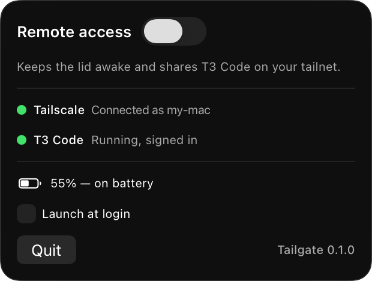
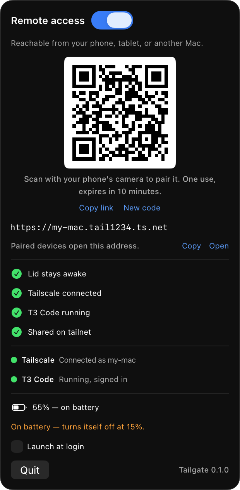

# Tailgate

Menu bar app that makes this Mac reachable from your phone, tablet or another
Mac: it keeps the lid awake, makes sure Tailscale is connected, makes sure
T3 Code is running, and shares T3 Code on your tailnet (with a QR code).

## Screenshots

| Menu bar popover | Remote access on (QR code) |
|--|--|
|  |  |

## Use case: open T3 Code from your phone

### Private: over your tailnet (Tailscale Serve)

This is what Tailgate does by default. Only devices signed in to your tailnet
can reach it.

1. Install Tailscale on your phone, sign in with the same account as the Mac,
   and keep it connected (also on mobile data).
2. On the Mac, click the Tailgate icon and turn on **Remote access**. Tailgate
   connects Tailscale, starts T3 Code in the background and shares it.
3. Scan the QR code with the phone's camera. It is a one-time T3 Code pairing
   link that signs the phone in; it expires after 10 minutes. For another
   device, click **Pair a device…** for a new code.
4. From then on the phone just opens the address shown under the QR code, e.g.
   `https://my-mac.tail1234.ts.net`. Close the lid and keep working.

Under the hood this is the same as:

```sh
tailscale serve --bg --https=443 3773   # T3 Code listens on localhost:3773
t3 auth pairing create --base-url https://my-mac.tail1234.ts.net   # the QR link
```

T3 Code only listens on `127.0.0.1`, so `http://my-mac:3773` won't work from
the phone; it has to go through Tailscale Serve. If HTTPS certificates are not
enabled for your tailnet, Tailgate falls back to
`http://my-mac.tail1234.ts.net:8080`.

If the phone can't load the page, check that its Tailscale app says
*Connected*, then run `tailscale ping <phone-name>` on the Mac; no reply means
the phone isn't on the tailnet.

### Public: on the internet (Tailscale Funnel)

Use Funnel when the other device can't run Tailscale, such as a borrowed
laptop. Tailgate doesn't turn Funnel on for you; do it by hand after Remote
access is on, and pair the device with **Pair a device…** as usual:

```sh
tailscale funnel --bg 3773   # same https://my-mac.tail1234.ts.net URL, now public
tailscale funnel status
```

Funnel has to be allowed for this device in your tailnet policy (the `funnel`
node attribute; the CLI prints a link to enable it if it isn't). Anyone with
the URL can reach T3 Code's sign-in page, so turn it off when you're done:

```sh
tailscale funnel --https=443 off
```

Turning Remote access off or quitting Tailgate removes only its own share
(e.g. `tailscale serve --https=443 off`), so switch Funnel off yourself as above.

## Install

```sh
./install.sh      # builds, copies to ~/Applications, launches, then runs the doctor
```

`install.sh` (or else the app's first toggle) asks for your admin password once
and installs three things: a small root helper that toggles lid sleep
(`/usr/local/libexec/tailgate-helper`), a narrow `sudoers` rule so later
toggles are instant, and the `tailgate` command (`/usr/local/bin/tailgate`, a
symlink into the app). By hand:
`sudo sh ~/Applications/Tailgate.app/Contents/Resources/install-helper.sh`.

## Command line

```sh
tailgate status          # Remote access, Tailscale and T3 Code at a glance (--json too)
tailgate on              # turn Remote access on; prints the address and a pairing QR code
tailgate off
tailgate pair            # a new one-time pairing QR code for another device
tailgate fix             # set up what's missing: installs, logins (--yes: no prompts)
tailgate doctor          # check everything, change nothing
tailgate start | quit    # start or quit the menu bar app
tailgate update          # install the latest release (--check: just look)
tailgate uninstall       # remove Tailgate, its helper and this command
```

`on`, `off` and `pair` go through the running app (and start it if needed), so
the menu bar and the terminal always agree.

## Health check

The popover always shows Tailscale and T3 Code status:

| | Checks |
|--|--|
| Tailscale | installed, daemon up, logged in, not turned off or awaiting approval |
| T3 Code | installed, running, signed in |

Red means a setup problem (not installed, not logged in or signed in): only
then is **Fix in Terminal…** shown, and Remote access won't start. Orange just
means not running; turning on Remote access starts it. **Fix in Terminal…**
runs `tailgate fix`, which is `doctor.sh --fix`:

```sh
tailgate doctor          # report only (exit 1 on problems); also ./doctor.sh
tailgate fix             # offer to brew-install, log in, launch what is missing
tailgate fix --yes       # same, no prompts
```

It also checks the node-key expiry, that the T3 server is listening and
exposed through Tailscale Serve, that an agent provider (Claude Code, Codex or
OpenCode) is logged in, and that the root helper and the `tailgate` command
are installed. Toggling Remote access
on runs the same prerequisites and stops with a specific message if one fails.

## Safety

- Turns itself off at 15% battery when unplugged (see [Preferences](#preferences)).
- Quitting the app revokes an unused pairing link, removes its own Tailscale
  Serve entry (anything else you serve is left alone) and restores normal sleep.
- If Tailscale or T3 Code is closed or turned off while Remote access is on,
  Tailgate starts it again within a few seconds. If it can't, or it now needs
  setup (e.g. logged out), Remote access turns off and the popover says why.
- Only one instance runs; a second launch exits immediately.
- The display still turns off; only system sleep is blocked. Keep the Mac on a
  hard surface, since a closed lid runs warm.

## Preferences

Tailgate finds Tailscale (the Mac app or a Homebrew CLI-only install), T3 Code
and T3 Code's port on its own. A few defaults can be changed with `defaults`;
they apply on Tailgate's next check:

| Key | Default | Meaning |
|--|--|--|
| `batteryCutoff` | `15` | Turn Remote access off at this battery % when unplugged; `0` = never |
| `servePort` | `443` | Preferred HTTPS port on the tailnet. If something else already serves on it, Tailgate uses 8443, 10000 or 4443 instead |
| `pairingMinutes` | `10` | How long a pairing QR code stays valid |
| `checkForUpdates` | `true` | Look for a newer release on GitHub once a day |

```sh
defaults write com.rakesh717.tailgate batteryCutoff -int 0   # never auto-off
defaults delete com.rakesh717.tailgate batteryCutoff         # back to default
```

## Updating

Tailgate checks GitHub for a newer release at launch and once a day. When there
is one, the popover shows **Update available** with **Install…**, which runs
`tailgate update` in Terminal:

```sh
tailgate update --check    # is there a newer release?
tailgate update            # download, verify, replace the app, relaunch
```

It verifies the download against the release's `SHA256SUMS`, its code signature
and its version, then quits Tailgate (Remote access turns off cleanly), swaps
the app in place and starts the new one, turning Remote access back on if it
was on. The helper, the `tailgate` command and preferences carry over.

## Manual override

```sh
sudo pmset -a disablesleep 0   # normal sleep
tailscale serve reset          # stop sharing (also removes anything else you serve)
```

## Uninstall

```sh
tailgate uninstall
```

It turns Remote access off, then removes the app, the helper, the sudoers rule,
the `tailgate` command, the login item and Tailgate's settings. Tailscale and
T3 Code are left alone. By hand:

```sh
tailgate quit                  # or quit from the menu: turns Remote access off
rm -rf ~/Applications/Tailgate.app "$HOME/Library/Application Support/Tailgate"
rm -f ~/Library/LaunchAgents/com.rakesh717.tailgate.plist
sudo rm -f /usr/local/libexec/tailgate-helper /etc/sudoers.d/tailgate /usr/local/bin/tailgate
sudo pmset -a disablesleep 0
defaults delete com.rakesh717.tailgate
```

## Releasing

```sh
echo 0.2.0 > VERSION                       # also add a CHANGELOG.md entry
./scripts/release.sh                       # dist/Tailgate-0.2.0.{dmg,zip} + SHA256SUMS
```

That build is universal (Apple silicon + Intel) but only ad-hoc signed, so
macOS asks users to right-click → Open the first time. For a trusted build you
need an Apple Developer ID:

```sh
xcrun notarytool store-credentials tailgate --apple-id you@example.com --team-id TEAMID
SIGN_IDENTITY="Developer ID Application: Your Name (TEAMID)" NOTARY_PROFILE=tailgate \
  ./scripts/release.sh
```

Pushing a tag `v0.2.0` runs `.github/workflows/release.yml`, which checks the
tag against `VERSION`, builds, and attaches the artifacts to a GitHub release.

## Icon

`Resources/AppIcon.icns` is generated: `swift tools/make-icon.swift .`
